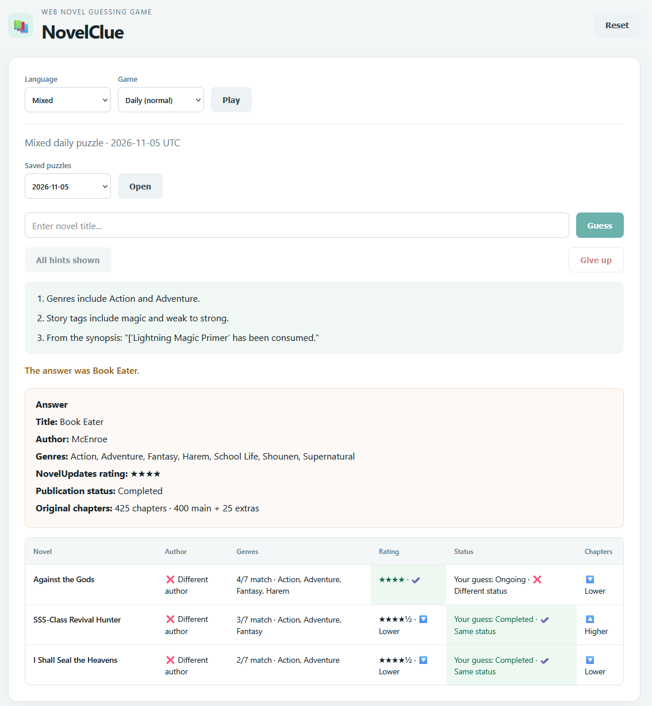

# NovelClue

[Play NovelClue](https://novelclue.onrender.com/)

A web novel guessing game built with Flask and PostgreSQL, using
NovelUpdates metadata.

Choose Chinese, Korean, or mixed mode. Normal mode provides a daily
puzzle with saved archives; hard mode provides additional random rounds
from a broader novel pool. Guesses receive comparison feedback, and
optional hints use collected genres, tags, and synopsis excerpts.

## Screenshots


## Features

- Chinese, Korean, and mixed-language modes
- Daily puzzles with saved puzzle archives
- Randomized hard-mode rounds from a broader novel pool
- Guess feedback comparing authors, genres, ratings, publication status,
  and chapter counts
- Optional hints generated from collected metadata
- PostgreSQL catalog containing 1,495 novels

## Tech stack

- Backend: Python, Flask, SQLAlchemy
- Frontend: JavaScript, HTML, CSS
- Database: PostgreSQL hosted on Neon
- Deployment: Render
- Database migrations: Alembic
- Data collection: Firefox extension and BeautifulSoup parsing

## Project structure

- `src/`: Flask application, metadata parsing, and maintenance commands
- `src/templates/`: Jinja HTML templates
- `src/static/`: styles
- `extension/`: Firefox metadata collector
- `config/`: dataset selection configuration
- `migrations/`: Alembic database migrations
- `tests/`: Python and JavaScript tests

## Local setup

Use Python 3.12 and PostgreSQL.

1. Create and activate a virtual environment.
2. Install dependencies: `python -m pip install -r requirements.txt`.
3. Copy `.env.example` to `.env` and configure PostgreSQL.
4. Run `python -m alembic upgrade head`.
5. Populate the database using a reviewed NovelUpdates import or a
   trusted database backup.
6. Preview answer pools with `python src/setup_answer_pools.py`.
7. Activate qualifying daily answers with
   `python src/setup_answer_pools.py --apply`.
8. Run `python src/app.py`.

Open http://127.0.0.1:5000/.

Migrations create the schema; they do not download or seed novel data.

## Game behavior

- Daily puzzle dates use UTC.
- Each language mode saves its puzzle when first requested that day.
- Past dates without saved puzzles are unavailable.
- Hard mode uses a broader pool and is separate from the daily archive.
- Player guesses and hint progress are currently held in the page and
  reset when it reloads.

## Data maintenance

Metadata is collected through the Firefox extension, parsed locally,
reviewed, and imported into PostgreSQL. Collection is separate from
web-server startup and is not automatically scheduled.

Metadata reflects its collection time. When extra chapter counts are
unknown, the game uses the known main-story count.

NovelUpdates and the source dataset are third-party data sources.
The project's MIT license applies to its code; it does not grant
rights to third-party novel descriptions or other source content.

## Tests

```bash
python -m unittest discover -s tests
npm ci
node tests/test_core.js
node tests/test_background.js
node tests/test_collector_tab.js
node tests/test_capture_dom.js
node tests/ui_checks.js
```

## Deployment

The live application runs on Render and connects to PostgreSQL on Neon.
The frontend and backend are served together by Flask.

Render settings:

- Build: `pip install -r requirements.txt`
- Start: `gunicorn --chdir src app:app --bind 0.0.0.0:$PORT`
- Health check: `/health`
- Environment: `DATABASE_URL`

Provision PostgreSQL and restore the reviewed catalog separately.
Run database migrations before serving the updated application.
Never commit credentials, browser profiles, or database backups.

## License

MIT License — see [LICENSE](LICENSE).